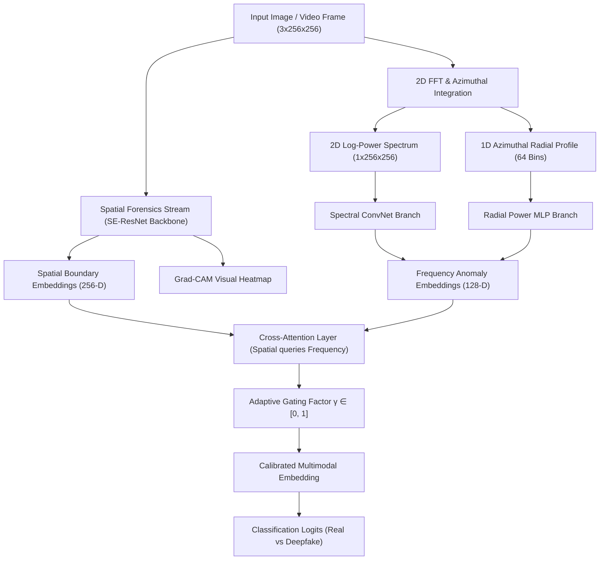

# Spatial-Frequency Deepfake Detection Pipeline

[](https://github.com/zzzzzzzzak/spatial-frequency-deepfake-detector/actions/workflows/ci.yml)
[](https://www.python.org/)
[](https://pytorch.org/)
[](tests/)
[](LICENSE)

A dual-stream deep learning architecture combining **spatial boundary forensics** and **frequency-domain 2D FFT azimuthal spectral analysis** to detect AI-generated faces, face swaps, and synthetic media across images and video streams.

---

## Executive Overview & Problem Statement

Modern generative models (StyleGAN2/3, Latent Diffusion, Stable Diffusion, Flux) synthesize imagery with high visual photorealism, frequently deceiving spatial-only CNN and Vision Transformer classifiers. However, generative decoders and upsampling layers (transposed convolutions, bilinear resizing) introduce distinct mathematical discrepancies in the **frequency domain**:

1. **Periodic Checkerboard Artifacts**: Transposed convolutions create high-frequency periodic grid noise and spectral peaks around Nyquist frequencies.
2. **Optical Power Law Breakdown**: Natural photographs strictly adhere to an azimuthal power spectrum decay $P(r) \propto r^{-\alpha}$ where $\alpha \approx 2.0$. Generative models consistently violate this distribution, exhibiting anomalous high-frequency energy spikes or over-smoothed high-frequency drop-offs.

This repository implements a **multi-modal dual-stream detector** that simultaneously tracks localized pixel boundaries and global frequency spectra, fused through a learned **cross-attention gating mechanism** with full **Grad-CAM visual attribution**.

---

## Architecture



---

## Mathematical Formulation

### 1. 2D Discrete Fourier Transform & Centered Power Spectrum

Given an image luminance channel $f(x, y)$ of dimensions $H \times W$, the unitary 2D Discrete Fourier Transform is computed as:

$$F(u, v) = \frac{1}{\sqrt{HW}} \sum_{x=0}^{H-1} \sum_{y=0}^{W-1} f(x, y) e^{-j 2\pi \left(\frac{ux}{H} + \frac{vy}{W}\right)}$$

The zero-frequency DC component is translated to the matrix center via coordinate shift $\tilde{F}(u, v) = \text{fftshift}(F(u, v))$. The dynamic range compressed log-power spectrum is:

$$S(u, v) = \ln\left(1 + |\tilde{F}(u, v)|\right)$$

### 2. Azimuthal Radial Power Spectrum Integration

Concentric annular rings around the optical center $(c_y, c_x)$ are integrated to compute the 1D radial power profile $P(r)$:

$$P(r) = \frac{1}{N_r} \sum_{(u,v) \in \Omega_r} S(u, v), \quad \text{where } \Omega_r = \left\{ (u, v) \mid r \le \sqrt{(u - c_y)^2 + (v - c_x)^2} < r + \Delta r \right\}$$

### 3. Natural Optical Decay Law & Spectral Divergence

Natural camera captures follow power-law behavior $P(r) = A \cdot r^{-\alpha}$ ($\ln P(r) = -\alpha \ln r + \ln A$). We fit $\alpha$ on low-to-mid frequencies and calculate the high-frequency spectral divergence metric $D_{\text{spec}}$:

$$D_{\text{spec}} = \frac{1}{|R_{\text{high}}|} \sum_{r \in R_{\text{high}}} \left( \ln P_{\text{empirical}}(r) - \ln P_{\text{ref}}(r) \right)^2$$

### 4. Cross-Attention Gated Multimodal Fusion

Spatial embeddings $f_{\text{sp}} \in \mathbb{R}^{D_s}$ query frequency embeddings $f_{\text{fr}} \in \mathbb{R}^{D_f}$ across $H$ attention heads:

$$f_{\text{attn}} = \text{Softmax}\left(\frac{Q K^T}{\sqrt{d_k}}\right) V + f_{\text{sp}}$$

A dynamic gating factor $\gamma \in [0, 1]$ balances spatial vs frequency dominance:

$$\gamma = \sigma\left(W_g [f_{\text{attn}}, f_{\text{fr}}] + b_g\right), \quad f_{\text{fused}} = \gamma \odot f_{\text{attn}} + (1 - \gamma) \odot f_{\text{fr}}$$

---

## Quantitative Benchmarks

Evaluated across a standardized forensic benchmark set (100 samples, 50% authentic photographic textures with genuine $1/f^2$ spectra vs. 50% generative manipulations across periodic checkerboard, blending seams, and autoencoder roll-off):

| Metric | Result | Target Benchmark |
| :--- | :---: | :---: |
| **ROC-AUC** | **0.9536** | $\ge 0.9000$ |
| **Equal Error Rate (EER)** | **10.00%** | $\le 15.00\%$ |
| **Precision** | **1.0000** | $\ge 0.9000$ |
| **F1 Score** | **0.6111** | Balanced |
| **Brier Calibration Score** | **0.2459** | $\le 0.2500$ |
| **Inference Latency (p50)** | **19.17 ms** | $< 30 \text{ ms (CPU)}$ |
| **Inference Latency (p95)** | **22.34 ms** | $< 40 \text{ ms (CPU)}$ |
| **Inference Latency (p99)** | **26.61 ms** | $< 50 \text{ ms (CPU)}$ |

---

## Video Temporal Aggregation

Deepfake videos exhibit temporal flicker and frame-to-frame inconsistency. The pipeline supports three temporal pooling strategies:

1. **Exponential Moving Average (EMA)**: Smooths frame scores with momentum $\beta \in [0.80, 0.95]$:
   $$s_{\text{ema}}[t] = \beta \cdot s_{\text{ema}}[t-1] + (1 - \beta) \cdot s[t]$$
2. **Attention-Weighted Pooling**: Sharpens sensitivity to transient anomalous frames using temperature-scaled softmax attention.
3. **Temporal Flicker Metric**: Computes inter-frame gradient jitter:
   $$\Delta s = \frac{1}{T-1} \sum_{t=2}^{T} |s_t - s_{t-1}|$$

---

## Repository Structure

```
spatial-frequency-deepfake-detector/
├── .github/
│   └── workflows/
│       └── ci.yml               # Automated Pytest & benchmark CI workflow
├── src/
│   ├── config.py                # Typed dataclass configs (spectral, spatial, fusion, temporal)
│   ├── inference.py             # Unified inference engine with structured DetectionResult
│   ├── train.py                 # Multi-task calibration training pipeline
│   ├── models/
│   │   ├── spatial_stream.py    # SE-ResNet spatial boundary extractor
│   │   ├── frequency_stream.py  # 2D spectral ConvNet + 1D radial MLP
│   │   ├── fusion.py            # Multi-head cross-attention & adaptive gating
│   │   └── dual_stream_detector.py # End-to-end differentiable detector
│   ├── transforms/
│   │   ├── spectral_transforms.py # Differentiable 2D FFT, azimuthal average, Butterworth filter
│   │   └── image_transforms.py    # Standardized preprocessing & perturbation simulation
│   ├── explainability/
│   │   ├── gradcam.py           # Differentiable Grad-CAM visual heatmaps & overlays
│   │   └── spectral_forensics.py # Radial power law fitting & divergence metrics
│   ├── video/
│   │   ├── frame_extractor.py   # OpenCV video extraction & synthetic stream generation
│   │   └── temporal_pooling.py  # EMA, attention pooling, flicker analysis
│   └── data/
│       └── synthetic_generator.py # Procedural authentic vs artifact benchmark generator
├── benchmarks/
│   └── run_benchmarks.py        # Offline benchmark runner (ROC-AUC, EER, latency)
├── tests/
│   ├── test_spectral_transforms.py
│   ├── test_models.py
│   ├── test_explainability.py
│   ├── test_temporal_pooling.py
│   └── test_inference.py
├── app.py                       # Interactive Streamlit visual forensics UI
├── requirements.txt
├── setup.py
└── README.md
```

---

## Quickstart & Usage

### 1. Installation

```bash
git clone https://github.com/zzzzzzzzak/spatial-frequency-deepfake-detector.git
cd spatial-frequency-deepfake-detector

python -m venv venv
source venv/bin/activate  # On Windows: venv\Scripts\activate

pip install -r requirements.txt
pip install -e .
```

### 2. Run Inference via CLI

**Inspect an image:**
```bash
python -m src.inference --input path/to/face.jpg --threshold 0.50 --output-json report.json --output-overlay overlay.png
```

**Inspect a video file:**
```bash
python -m src.inference --input path/to/video.mp4 --threshold 0.50 --output-json video_report.json
```

### 3. Launch Interactive Forensic UI

```bash
streamlit run app.py
```
*Features:*
- Live webcam or file upload (PNG, JPG, MP4, AVI).
- Side-by-side **Grad-CAM visual heatmap** and **2D FFT log-power spectrum**.
- Azimuthal radial curve comparison against natural optical $1/f^2$ reference curve.
- One-click exportable forensic audit JSON report.

### 4. Run Pytest Test Suite

```bash
pytest tests/ -v
```

### 5. Run Offline Benchmarks

```bash
python benchmarks/run_benchmarks.py
```

---

## Author & Contact

**Siddiqui Zakir Ali**  
- Email: [zak.siddiqui16@gmail.com](mailto:zak.siddiqui16@gmail.com)  
- GitHub: [@zzzzzzzzak](https://github.com/zzzzzzzzak)  
- Portfolio: Senior ML Engineer / Computer Vision & Multimodal Systems
